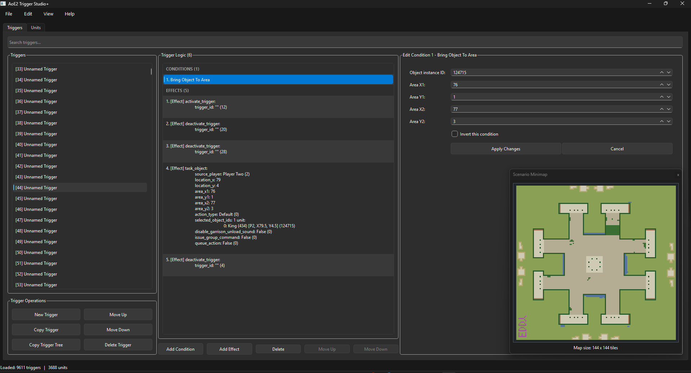

# AoE2 Trigger Studio+

AoE2 Trigger Studio+ is a desktop scenario and trigger editing tool for **Age of Empires II: Definitive Edition**.

The project is inspired by the trigger-editing workflow of **AoKTS** and is being developed as a modern tool for creating, inspecting, editing, and managing AoE2 scenario triggers.

> **Development status: Alpha / Work in Progress**
>
> AoE2 Trigger Studio+ is under active development and is not yet considered ready for general release.
>
> Always keep backup copies of important `.aoe2scenario` files before editing them with development builds.

## Screenshot



## Current Features

### Scenario Management

- Create new scenarios
- Open existing `.aoe2scenario` files
- Save and Save As
- Track unsaved changes
- Scenario minimap
- Scenario information and unit count
- Trigger export

### Trigger Management

- Create triggers
- Rename triggers
- Delete triggers
- Move triggers up and down
- Copy triggers
- Copy trigger trees
- Cut and paste triggers
- Copy a trigger for all eight players
- Randomize trigger order
- Blank all trigger names
- Search triggers
- Preserve trigger identity when moving triggers

### Trigger Logic

AoE2 Trigger Studio+ provides a Trigger Logic workspace for working with conditions and effects.

Current functionality includes:

- Add conditions
- Edit conditions
- Delete conditions
- Reorder conditions
- Change an existing condition to another condition type
- Undo and Redo
- Condition-specific Item Editors

Condition support is being expanded systematically using the condition order presented by the Age of Empires II DE Scenario Editor.

Examples of currently supported conditions include:

- Accumulate Attribute
- AI Signal
- Bring Object To Area
- Bring Object To Object
- Building Is Trading
- Capture Object
- Chance
- Compare Variables
- Condition Joiner
- Condition Separator
- Decision Triggered
- Destroy Object
- Objects In Area
- Own Fewer Objects
- Own Objects
- Research Technology
- Timer

Additional conditions are actively being implemented.

## Condition Joiners

Trigger Studio+ uses the same user-facing terminology as the AoE2 DE Scenario Editor:

- **Condition Joiner** represents the game's `AND` condition.
- **Condition Separator** represents the game's `OR` condition.

## Undo and Redo

Editing operations use a command-based Undo/Redo system.

Supported command-based operations include condition creation, condition editing, logic-object deletion and movement, trigger renaming, and trigger reordering.

## Technology

AoE2 Trigger Studio+ is currently developed using:

- Python 3.10
- PySide6
- AoE2ScenarioParser 0.9.8
- PyInstaller for Windows test builds

## Installation

There is currently **no stable public release**.

The project is still in active development.

For development, clone the repository and install the Python dependencies:

```powershell
python -m pip install -r requirements.txt
```

Then run:

```powershell
python main.py
```

A packaged Windows version is also being tested and will be made available when the application reaches a suitable alpha-release milestone.

## Project Status

The current focus is completing support for AoE2 trigger conditions.

Development is proceeding through the in-game condition list systematically, with each condition tested for:

1. Creation
2. Editing
3. Undo and Redo
4. Changing condition type
5. Saving and reloading
6. Compatibility with the AoE2 DE Scenario Editor

After condition support is sufficiently complete, development will continue through the effects list using the same process.

## Safety

AoE2 Trigger Studio+ modifies scenario files.

During the alpha development phase:

- Keep backups of important scenarios.
- Prefer **Save As** when testing changes.
- Test modified scenarios in the Age of Empires II DE Scenario Editor before relying on them for distribution.
- Do not assume every AoE2 condition or effect is supported yet.

## Contributing

The project is not yet formally open for contributions while the core architecture and trigger-editing functionality are being established.

Bug reports and compatibility observations will become increasingly useful as the project approaches its first public alpha release.

## Acknowledgements

AoE2 Trigger Studio+ uses **AoE2ScenarioParser** for reading and modifying Age of Empires II scenario data.

The project is also inspired by the workflow and usability of **AoKTS**.

## Disclaimer

AoE2 Trigger Studio+ is an independent community project.

It is not affiliated with, endorsed by, or supported by Microsoft, Xbox Game Studios, World's Edge, or Forgotten Empires.

Age of Empires and Age of Empires II are trademarks of their respective owners.

## License

Copyright © 2026 Lloyd Tench

AoE2 Trigger Studio+ is licensed under the GNU General Public License
version 3.0 (GPL-3.0).

See [LICENSE](LICENSE) for the full license terms.

Third-party components used by AoE2 Trigger Studio+ remain subject to
their respective licenses. See
[THIRD_PARTY_LICENSES.md](THIRD_PARTY_LICENSES.md) for details.
